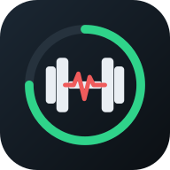

# 🏋️ ניהול אימון בחדר כושר

אפליקציה אישית לתכנון וניהול אימונים בחדר כושר. היא מותקנת בטלפון כאפליקציה עצמאית (PWA), עובדת בלי אינטרנט, וכל הנתונים נשמרים רק בטלפון.



## התקנה בטלפון אנדרואיד
1. פותחים ב־**Chrome** את כתובת האפליקציה: `https://yarivbrabbing-lang.github.io/gym-trainer/`
2. לוחצים על תפריט ⋮ ובוחרים **התקן אפליקציה** (או **הוסף למסך הבית**).
3. האייקון מופיע במסך הבית. האפליקציה נפתחת במסך מלא ועובדת גם בלי אינטרנט.

### העברת נתונים מהגרסה הקודמת (claude.ai)
1. בגרסה הישנה: ⚙️ הגדרות ← **העתק גיבוי כטקסט**.
2. באפליקציה המותקנת: ⚙️ הגדרות ← **הדבק גיבוי** ← מדביקים ← **שחזר**.

### גיבוי
הנתונים נשמרים בטלפון בלבד. מומלץ מדי פעם: ⚙️ ← **שמור גיבוי לקובץ**. הקובץ נשמר בתיקיית ההורדות. לשחזור: **טען גיבוי מקובץ**.

### סנכרון לענן (Google Drive)
- הנתונים נשמרים בתיקייה מוסתרת (appDataFolder) בחשבון ה־Google שלך.
- ההרשאה היחידה היא `drive.appdata`, ולכן האפליקציה לא רואה קבצים אחרים ב־Drive.
- **הפעלה:** ⚙️ ← מדביקים את ה־Client ID ← "שמור והפעל" ← "התחבר וסנכרן".
- **סנכרון אוטומטי:** אחרי כל שינוי, כל עוד יש חיבור. ההתחברות תקפה כשעה. אחר כך לוחצים על "☁️ סנכרן" בכותרת.
- **מיזוג בין מכשירים:** ההגדרות והתכנון נלקחים מהמכשיר שעודכן אחרון. אימונים משני המכשירים נשמרים. אם אותו יום אימון קיים בשניהם, נשמרת הגרסה עם יותר סטים.
- **פרטי ההגדרה ב־Google Cloud:**
  - Google Auth Platform ← Clients ← Web application.
  - Authorized JavaScript origin: `https://yarivbrabbing-lang.github.io`
  - Drive API מופעל.
  - Audience: External ← Testing, והמשתמש מוגדר כ־Test user.

## מה יש באפליקציה
- **תרגילים**: 7 קבוצות שריר, עד 5 תרגילים בכל קבוצה. לכל תרגיל: סטים, חזרות, משקל, מנוחה בין סטים, מספר מכשיר והערות.
- **סיבולת לב ריאה**:
  - הליכה או ריצה: דקות, ק״מ ושיפוע. אינטרוולים רק בריצה.
  - דופק לפני ואחרי התרגיל.
  - עריכת המרחק בפועל אחרי הסימון.
- **יומן שנתי וחודשי**:
  - תכנון ימים, העברה לתאריך אחר ושכפול שבועי.
  - כל אימון נפתח ונסגר באירובי.
  - איזון עומסים בין קבוצות שריר, כולל כפתור "בנה אימון מאוזן".
- **אימון**:
  - סימון כל סט. אחריו רצה מנוחה, והסט הבא נעול עד סופה.
  - אחרי הסט האחרון: מנוחה בין תרגילים (ברירת מחדל 10 דקות), ורק אז נפתח התרגיל הבא.
  - אפשר לשנות כל זמן מנוחה בכל רגע.
  - צפצוף ורטט בסוף המנוחה.
  - תרגיל שבוצע נצבע באדום.
  - המסך נשאר דלוק במהלך האימון.
- **סיכום חודשי**:
  - אימונים, ק״ג שהורמו וק״מ.
  - חלוקת עומס לפי קבוצת שריר.
  - השוואת דופק לחודש הקודם, עם המלצות.
- **נגישות**:
  - שלושה גדלי טקסט.
  - כפתורים גדולים.
  - ניגודיות גבוהה.
  - תמיכה בקורא מסך.
  - מסך עזרה (❓).

## מבנה הקוד
| קובץ | תפקיד |
|---|---|
| `index.html` | כל האפליקציה (HTML, CSS ו־JS בקובץ אחד, בלי תלויות חיצוניות) |
| `manifest.webmanifest` | הגדרות ההתקנה: שם, אייקונים, צבעים, RTL |
| `sw.js` | Service Worker לעבודה בלי אינטרנט |
| `*.png`, `logo.svg` | הלוגו ואייקונים בגדלים שונים (192/512, maskable, אפל, favicon) |
| `tests/` | בדיקות אוטומטיות (Playwright) |
| `tools/build_artifact.py` | בונה גרסה ל־claude.ai בלי תגיות PWA |

### עקרונות שחשוב לשמור
- **אבטחה**:
  - כל טקסט של המשתמש עובר `esc()` לפני הצגה.
  - כל נתון שנטען (מהאחסון או מגיבוי) עובר `sanState()`.
  - אין `eval`, אין handlers בתוך ה־HTML (כל הפעולות דרך `data-a`), ואין קריאות לאתרים חיצוניים.
- **מצב**: הכול באובייקט `S`. כל שינוי נשמר דרך `commit()`.
- **טיימר**: מבוסס על `endsAt` (זמן אמיתי), ולכן ממשיך נכון גם אחרי סגירה ופתיחה.

## פרסום גרסה חדשה
1. מעדכנים את `index.html`.
2. **מעלים את `VERSION` ב־`sw.js`**, אחרת הטלפון ימשיך להציג את הגרסה הקודמת.
3. מריצים בדיקות (למטה) ודוחפים ל־`main`. GitHub Pages מתעדכן תוך כדקה.
4. באפליקציה תופיע הודעה "גרסה חדשה מוכנה". לוחצים **רענן**.

## הרצת בדיקות
```bash
pip install playwright && python -m playwright install chromium
python tests/test_flow.py "$PWD/index.html"     # זרימה מלאה (86 בדיקות)
python tests/test_edge.py "$PWD/index.html"     # מקרי קצה ואבטחה (30 בדיקות)
python -m http.server 8765 &                    # שרת מקומי לבדיקת PWA
python tests/test_pwa.py                         # התקנה, אופליין, גיבוי לקובץ (11 בדיקות)
python tests/test_cloud.py                       # סנכרון Drive עם Google מדומה (23 בדיקות)
```
